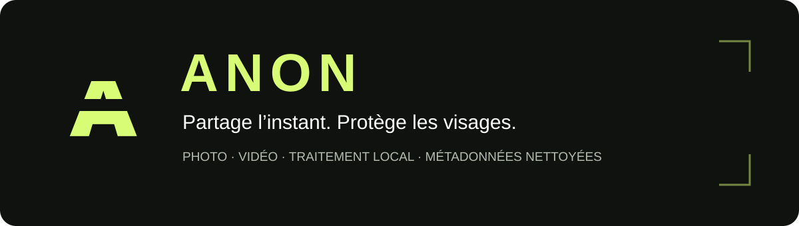

<p align="center">
  
</p>

<p align="center"><strong>Des portraits fictifs. Du flou. Un traitement directement sur ton téléphone.</strong></p>

<p align="center">
  <a href="https://github.com/Nozomagarion/anon/releases/latest">Télécharger pour Android</a> ·
  <a href="ios/README.md">Projet iOS</a> ·
  <a href="#comment-ça-marche">Comment ça marche ?</a>
</p>

## Partager une scène sans exposer tous les visages

Une photo de groupe, une vidéo d’événement, un souvenir à publier : on ne veut pas toujours montrer tous les visages qui apparaissent à l’image.

**ANON te permet de choisir les visages à masquer sur une photo et de traiter automatiquement tous les visages détectés dans une vidéo.** L’app remplace les zones sélectionnées par des portraits fictifs opaques, puis applique du flou à ces portraits. Elle nettoie aussi les métadonnées des nouveaux exports.

Sans compte, sans abonnement et sans serveur de traitement. L’interface est en français et le moteur fonctionne directement sur le téléphone.

## Ce que tu peux faire

| | Avec ANON |
| --- | --- |
| **Choisir sur une photo** | Toucher les cadres pour masquer certains visages et en garder d’autres visibles. |
| **Corriger la sélection** | Tout sélectionner, tout désélectionner ou dessiner une zone oubliée. |
| **Automatiser une vidéo** | Analyser chaque image décodée et remplacer tous les visages détectés. |
| **Ajuster le rendu** | Régler le flou et changer les portraits fictifs utilisés. |
| **Nettoyer les exports** | Retirer automatiquement GPS, EXIF, XMP, auteur, appareil et dates d’origine intégrées. |
| **Garder ses originaux** | Créer un nouveau fichier sans modifier le média importé. |

## Comment ça marche ?

### 1. Importe ton média

Choisis une photo ou une vidéo avec le sélecteur du téléphone. Sur iOS, tu peux aussi importer depuis Fichiers.

### 2. Choisis ce qui doit être masqué

**Sur photo**, les visages détectés sont encadrés. Touche un cadre pour activer ou désactiver le remplacement. Utilise **Tous**, **Aucun** ou **+ Zone** pour ajuster la sélection.

**Sur vidéo**, tous les visages détectés sont concernés. L’export analyse chaque image décodée, avec un suivi géométrique pour limiter les interruptions entre deux détections.

### 3. Remplace, floute, exporte

```text
Visage détecté → portrait fictif opaque → flou du portrait fictif → export aplati
```

Le flou est calculé sur le **portrait fictif**, puis cette texture remplace la zone du visage. Les pixels du visage d’origine ne sont pas mélangés à l’intérieur du rectangle couvert. Quatre portraits fictifs sont fournis avec l’app : aucune génération en ligne n’est nécessaire.

Ajuste le flou, vérifie le résultat, puis exporte en **PNG** pour les photos ou en **MP4** pour les vidéos. Le son des vidéos est conservé ou réencodé en AAC. Garde l’app ouverte pendant l’export ; le traitement peut être annulé.

## La confidentialité fait partie de l’export

Le fichier final est créé à partir du rendu et nettoyé avant d’être proposé à l’enregistrement ou au partage :

- **Photos :** suppression des blocs EXIF, GPS, XMP, texte et autres métadonnées descriptives.
- **Vidéos :** suppression des données descriptives et des dates absolues intégrées au conteneur.
- **Noms :** création d’un nom aléatoire, sans reprendre le nom ou la date du média source.

Les informations nécessaires à la lecture, comme les dimensions, les codecs et la durée, restent présentes. Le système et la galerie attribuent leurs propres dates au **nouveau fichier**. Les anciens exports ne sont pas nettoyés rétroactivement.

Sur Android, l’app ne demande aucune permission Internet. Sur iOS, le sélecteur système peut récupérer un original stocké dans iCloud ; le traitement dans ANON reste local.

## Télécharger et essayer

| Plateforme | Disponibilité |
| --- | --- |
| **Android 10+ · ARM64** | [APK v0.1.1 dans les releases](https://github.com/Nozomagarion/anon/releases/latest), environ 16 Mo. Compilation et tests Android effectués. |
| **iPhone / iPad · iOS 16+** | [Projet SwiftUI fourni](ios/README.md). Les tests du code commun passent ; la compilation avec le SDK Apple et les essais sur iPhone restent à faire. |

**Android :** télécharge `ANON-0.1.1-android-arm64.apk` depuis la release, ouvre le fichier sur ton téléphone, puis autorise cette source d’installation si Android le demande. Cette version est signée avec une clé de développement.

**iOS :** ouvre `ios/ANON.xcodeproj` sur un Mac avec Xcode, configure ton équipe Apple pour la signature et lance l’app sur ton iPhone. Aucun IPA signé ni téléchargement App Store n’est disponible pour le moment. [Guide iOS →](ios/README.md)

## Avant de diffuser

ANON protège les **zones effectivement remplacées**. Un petit visage, un profil, un visage masqué ou une image floue peut échapper à la détection. Les vêtements, les cheveux, la voix et le contexte peuvent aussi permettre de reconnaître quelqu’un. **Vérifie toujours l’export avant de le partager.**

Les portraits sont des textures frontales placées dans des rectangles, pas un face swap neuronal qui suit la pose. Les vidéos HDR ne sont pas prises en charge dans cette version. La vitesse dépend du téléphone et du média ; le temps réel n’est pas garanti.

Sur Android, l’aperçu vidéo est allégé et l’export utilise une détection plus approfondie. Sur iOS, l’aperçu avant export montre la première image ; la vidéo traitée peut être lue après l’export.

## Pour les curieux et les développeurs

Deux applications natives, avec des composants adaptés à chaque plateforme :

- **Android :** Kotlin, vues natives, ML Kit embarqué, Media3 et rendu OpenGL.
- **iOS :** SwiftUI, Vision, Core Image, AVFoundation et PhotoKit.

Le code commun iOS dispose de **7 tests Swift exécutés**. Les tests Android couvrent notamment le remplacement opaque, le parcours photo, les métadonnées et le passage de chaque image dans le moteur vidéo. Les tests nécessitant les frameworks iOS sont préparés et restent à exécuter sur Mac.

| En savoir plus | Documentation |
| --- | --- |
| Compiler Android et comprendre le moteur | [Documentation Android](docs/ANDROID.md) |
| Compiler et installer la version iOS | [Guide iOS](ios/README.md) |
| Consulter les vérifications effectuées | [Validation Android](docs/VALIDATION.md) · [Validation iOS](ios/VALIDATION.md) |
| Comprendre l’origine des portraits fictifs | [Assets et prompt de génération](docs/ASSETS.md) |

Les vidéos personnelles de test, les exports locaux, les clés de signature et la configuration propre au poste ne sont pas inclus dans le dépôt.

## Inspiration

ANON s’inspire du principe présenté par [Baskl Anonymizer](https://bskl.xyz/anonymizer) : remplacer un visage avant de le flouter. Le projet est indépendant, sans affiliation avec Baskl, et n’utilise ni son code propriétaire ni ses modèles. Il ne promet pas une anonymisation absolue ni un résultat « jamais défloutable » sur l’ensemble d’un média.
